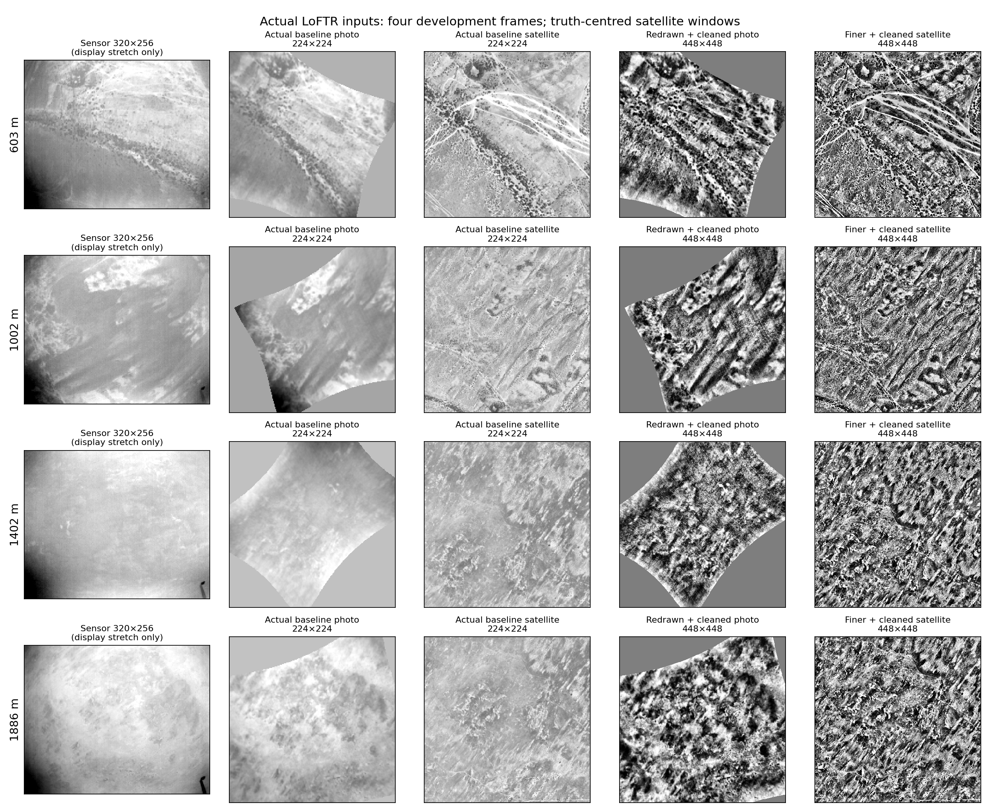
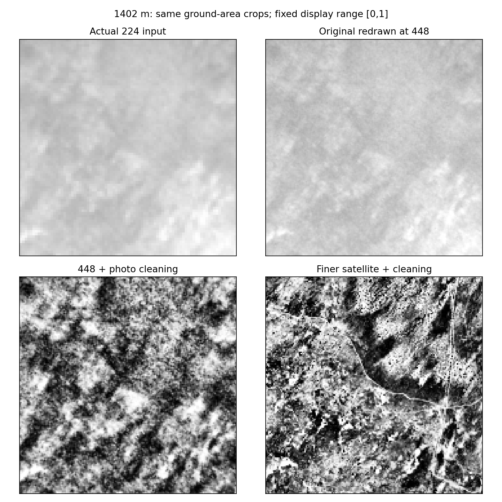
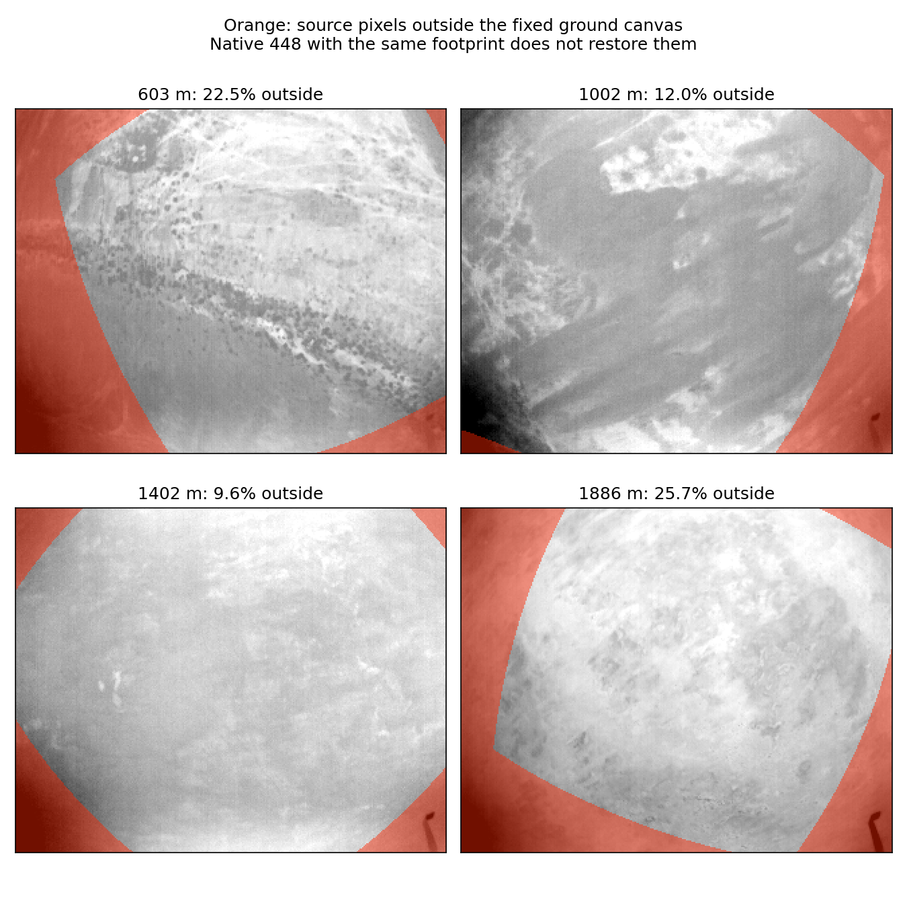

# What is lost before LoFTR, and what can be preserved?

Yes: the baseline attenuates small visible structures before LoFTR. Some can be preserved by rendering directly from the original frame at finer ground sampling. Other satellite details have weak or absent thermal counterparts, so preserving pixels alone cannot make the pair match.

This inspection reconstructed four **development** frames selected by height (603, 1002, 1402 and 1886 m), using current `Main_Pipeline_Headless` functions directly. The satellite tiles are at supplied truth, read from the existing server map store. They diagnose representation, not candidate selection. No new inference, training, threshold fitting, locked-image access or production edits occurred. The executed notebook contains the figures and measurements; `results/provenance_codex.json` records source and array hashes.

## What I actually see

- At 603 m the raw frame contains distinct spot groups, intersecting boundaries and broader tracks. Most broad layout survives, while small spots become softer. The satellite has many more crisp narrow tracks.
- At 1002 m the bright cluster with dark centres and the elongated streaks remain recognizable in the baseline. Finer direct rendering separates small boundaries more clearly; cleaning makes faint spot groups stand out. It also makes fine noise conspicuous.
- At 1402 m the original contains faint mottled texture and small bright flecks. In the baseline these merge into smoother patches. Direct rendering keeps more texture; vignette removal and local normalization expose the clump arrangement. These are not automatically reliable corresponding landmarks: the cleaned satellite still has sharp linear features not visibly reproduced in the thermal crop.
- At 1886 m broad dark clumps and a diagonal bright band survive in the source and baseline. Many small structures were already poorly resolved by the thermal sensor. Cleaning makes the remaining pattern stronger, but does not produce the satellite's detailed track network.

The panels use a fixed display range and nearest-neighbour display. These are the actual floating-point input values, not separate per-panel contrast stretches. The baseline crop has 84 samples per side; the finer crop has 168 over the same ground extent. Residual geometry and modality differences remain; these are not manually aligned landmark correspondences. The noisy appearance after cleaning is a reason to validate matching, not evidence of additional captured information.

## Where information is attenuated or excluded

The baseline path is raw uint16 -> percentile stretch + CLAHE -> Gaussian preblur -> one bilinear geometric remap into 224 x 224 -> mean fill outside the valid photo -> float32 clipping to [0,1] -> LoFTR. DINO's embeddings and its own preprocessing do **not** replace these grayscale inputs. The preblur and sampling formulas also exist in research `src/image_processing/geometry.py`.

| Example height | Nominal source m/px | Baseline m/px | Direct finer m/px | Baseline preblur sigma, source px | Gradient RMS retained after preblur |
|---|---:|---:|---:|---:|---:|
| 603 m | 2.98 | 4.80 | 2.40 | 0.556 | 68.9% |
| 1002 m | 4.95 | 9.60 | 4.80 | 0.719 | 50.8% |
| 1402 m | 6.93 | 13.58 | 6.79 | 0.730 | 39.8% |
| 1886 m | 9.32 | 13.58 | 6.79 | 0.478 | 76.2% |

GSD here is nominal height/fx, before local attitude, distortion and the 1.04 projection scale. Gradient RMS compares the same normalized sensor grid before and after Gaussian blur, excluding a four-pixel rim. It includes noise and artefacts; **39.8% gradient retention does not mean 60.2% of useful features were lost**. At 1002–1402 m each coarse pixel spans about twice a source pixel in each direction. Features only a few source pixels across are particularly vulnerable. Some smoothing is necessary to avoid aliasing when shrinking; disabling blur globally is not a justified fix.

Percentile clipping discards intensity extremes and CLAHE changes local brightness relationships, but the observed main spatial loss is smoothing plus coarser sampling. CLAHE does not remove the strong radial brightness field. Cleaning exposes existing weak contrast; it can also exaggerate noise. The raw source remains 320 x 256, even when represented on a 448 square canvas.

**A second loss is geometric cropping.** Projecting every raw pixel centre onto the ground using the same camera, attitude and scale shows that some source pixels lie outside the fixed square canvas:

| Height | Source pixel centres outside canvas |
|---|---:|
| 603 m | 22.5% |
| 1002 m | 12.0% |
| 1402 m | 9.6% |
| 1886 m | 25.7% |

This is source-grid coverage, not a useful-feature loss rate. Distortion inversion was checked by reapplying the actual distortion function with maximum residual below 1e-5 source pixel. The 448 path covers the **same ground footprint**, so it does not restore these omitted edge regions. There is also mean-grey padding inside the square: about 12–35% of its area in these examples. Padding fraction and source cropping are different quantities. Padding is passed into LoFTR without the validity mask; it is not ground texture.

## What the existing matching results support

I recomputed Iteration 34's CSV rather than rerunning its model sweep. These are 142 development photos above 800 m, best inliers over six standard queries at the supplied true location:

| Input variant | Frames with >=8 true-place inliers | Wrong-place controls with >=8 |
|---|---:|---:|
| Baseline 224 | 57/142 (40.1%) | 0/142 |
| Cleaned photo and map, 224 | 62/142 (43.7%) | 0/142 |
| Direct native 448, no cleaning | 44/142 (31.0%) | 0/142 |
| Direct native 448 + photo/map cleaning | 72/142 (50.7%) | 0/142 |
| Native 448 + cleaning + denoise/boost | 64/142 (45.1%) | 0/142 |

The combination matters: more sampling alone makes this diagnostic worse. Cleaning and preserving sampling together is the best tested lead here. Enlarging the already rendered 224 input does not recover source detail; the notebook includes this visual control, without claiming matcher results for it.

These counts are **not** full-pipeline scores or accepted correct locations. The oracle diagnostic omits coarse selection and the final centre-shift gate. A fixed 3-pixel RANSAC threshold also covers half the physical distance at the finer level. Zero false detections on these limited distant-tile controls is not a guarantee of zero wrong answers across a full candidate search. No new wrong-answer (>8 sigma) rate was measured by this inspection. The newer `Headless_Native_Analysis.ipynb` and `Matchers_At_Height.ipynb` have protocols but no populated local execution results at inspection time; `results/native_fine/` contains only the development metadata.

## Changes worth carrying forward

1. **Existing optional native-fine path:** keep coarse search at 224; for fine verification redraw from the raw frame at a finer map level and get the map tile at that level, with the same ground footprint and compatible photo/map cleaning. This already exists in `geoloc/native_fine.py`; `NATIVE_FINE_FROM_HEIGHT_M=None` keeps it off by default. It costs about four times as much per candidate in the earlier report, so its headless timing and score need checking.
2. **New coverage experiment:** inspect the orange omitted areas, then compare a geometry-sized fine canvas or overlapping native-resolution windows that retain useful peripheral structure. Use matching map windows and correct centre/shift coordinates. Do not shrink a larger footprint back into 224. Keep camera shading and the fixed corner hook excluded as nuisances. Extra coverage and native resolution are separate changes, and no matching benefit for extra coverage has been measured here.
3. **Validity-aware matching:** evaluate carrying an appropriately downsampled/eroded validity mask into LoFTR so grey padding and warp borders cannot create support. It preserves attention for real content, but does not restore cropped content. This is an untested follow-up, not an enabled change.

Do not spend the next round on simply enlarging 224, stronger global sharpening, heavier denoising, or a bigger edge sigma. The first cannot recover discarded samples; the others already have negative or weak experimental evidence. A learned reconstruction can create plausible details without establishing true correspondences, so it is not a preservation certificate.

Before enabling anything, require full old-official, NUDT and new-development evaluation with frozen decision rules, wrong answers beyond 8 sigma beside scores, and measured time inside the budget. Choose any gate from physical sampling/quality evidence and development validation, not from locked-test performance. No drone-image training is needed for the proposed input-preservation changes.

## Artifacts and execution

- `LoFTR_Input_Inspection_executed_codex.ipynb`: actual sequential IPython execution, rich outputs retained; no separate kernel process.
- `results/exact_input_arrays_codex.npz`: original uint16 frames, intermediate arrays, actual baseline and optional fine input arrays, masks and enlarged controls.
- `results/map_windows_codex.npz`: original stored map windows, including unused distant controls and extraction provenance. Only true windows were used for this visual inspection.
- `results/sampling_measurements_codex.csv`, `existing_iteration34_recomputed_codex.csv`, `provenance_codex.json`: measurements and hashes.

Execution used `tools/run_capped.sh` with a 3 GB memory cap and two CPU cores. No GPU was used. No production source, trained weights or defaults were changed. The whole inspection folder can be removed independently. Notion mirror remains pending because no Notion connector is available in this session.
