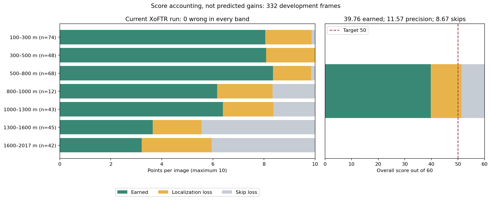

# Why the current result is about 40/60, and what 50+ would require

The new results have moved the bottleneck. XoFTR has already improved recovery substantially; **accepted-location precision is now the largest remaining score deficit overall**. Reaching 50+ requires a substantial change in localization quality as well as safer recovery of skipped images. No completed experiment currently establishes a transferable 50+ configuration.

This is an analysis of saved development results, not another parameter search. The executed notebook reproduces the tables and bounds. No new training, inference, production changes, image inspection or locked-result CSV access occurred. Previously published locked-test headline scores are quoted only as historical results.

## 1. Which result is current?

All four rows below use the same 332 development images, jittered hints and the headless pipeline. Wrong means a returned position beyond 8 scoring sigma.

| Completed configuration | Score /60 | Answered /332 | Wrong | Mean server seconds/image |
|---|---:|---:|---:|---:|
| LoFTR baseline | 35.64 | 247 | 0 | 2.20 |
| LoFTR, native rendering + cleaning from 800 m | 37.79 | 259 | 0 | 4.25 |
| XoFTR from 800 m, ordinary 224 input | **39.76** | **284** | **0** | **1.78** |
| XoFTR + native rendering/cleaning from 800 m | 39.18 | 281 | 0 | 2.58 |

The saved documentation also reports the frozen XoFTR configuration at **40.61/60, 0 wrong**, versus **38.00/60, 0 wrong** for its base on the 168-image test run. That is encouraging transfer within this acquisition, not a new selection set. Do not use its band-wise results to choose the next gate or hybrid. The locked split has already been used twice.

The current settings file still defaults `XOFTR_FROM_HEIGHT_M=None` and `NATIVE_FINE_FROM_HEIGHT_M=None`. Thus 39.76 describes the tested experimental configuration, not proof that the deployed default or frozen submission runs it. The older 36.35/60 baseline uses 500 images and should not be mixed with this 332-image comparison.

## 2. Exact score budget

For the current XoFTR development run:

- 148 answers earn 10 points, 104 earn 6, 32 earn 3, and 48 images are skipped.
- Total earned points: 2200; score = 6 × 2200 / 332 = **39.76**.
- Accepted answers leave 640 points unearned through localization imprecision: **11.57/60**.
- Skips leave 480 points unearned: **8.67/60**.
- Wrong-answer deficit: **0** in this run.

These sum to the full gap: 39.76 + 11.57 + 8.67 = 60. They are accounting headroom, not predictions that every loss can be recovered. Ground-truth noise, map alignment and missing modality information may make some of it irreducible.

Three decisive counterfactuals:

| Hypothetical intervention | Score /60 | Wrong by construction | Meaning |
|---|---:|---:|---|
| Every current skip becomes a perfect answer; existing answers unchanged | **48.43** | 0 | Recovery alone cannot reach 50 on these images. |
| Every existing accepted answer becomes perfect; skips remain | **51.33** | 0 | Precision has enough mathematical headroom, but almost all must be recovered to reach 50 without more answers. |
| Truth chooses the highest-point saved output per image from the four configurations above | **43.36** | 0 | Selecting among these completed outputs alone cannot reach 50. This oracle is not deployable. |

The oracle does not bound a new geometry method, matcher, confidence rule or candidate search that creates different outputs. It only bounds selection among the four stored output sets. Thirty-two images have no answer in any of those sets; only 173 have a full-point answer in at least one.

To reach 50 needs at least 567 additional raw points. For scale, recovering 24 skips at full points and moving 84 current six-point answers to ten would yield **50.17/60 with 0 wrong, by assumption**. That is a demanding hypothetical workload, not a forecast. Another useful target is roughly 95% answered with about 8.8 points per accepted answer and negligible wrong answers; current coverage is 85.5% with 7.75 points per accepted answer.

## 3. What drops at each height band?

The following are current XoFTR outputs. Loss columns are contributions to the overall 60-point score, not band scores. There are **0 wrong in every band**.

| Height, m | n | Answered | Mean points /10 | Full-point answers | Precision loss /60 | Skip loss /60 |
|---|---:|---:|---:|---:|---:|---:|
| 100–300 | 74 | 73 | 8.05 | 44 | 2.42 | 0.18 |
| 300–500 | 48 | 48 | 8.08 | 31 | 1.66 | 0.00 |
| 500–800 | 68 | 67 | 8.35 | 43 | 1.84 | 0.18 |
| 800–1000 | 12 | 10 | 6.17 | 5 | 0.47 | 0.36 |
| 1000–1300 | 43 | 36 | 6.40 | 17 | 1.54 | 1.27 |
| 1300–1600 | 45 | 25 | 3.64 | 5 | 1.55 | 3.61 |
| 1600–2017 | 42 | 25 | 3.21 | 3 | 2.08 | 3.07 |

**100–800 m: predominantly a precision problem.** There are only two skips among 190 images. More permissive acceptance has almost no useful work here. The 100–300 m group contributes the largest low-height deficit, partly because it is the largest group. Candidate causes include metadata attitude/height error, camera-to-body convention, residual projection model error, terrain or map/label alignment. The saved CSV does not identify which causes how much. The historical pointing fit explained a limited fraction and hurt elsewhere; fitting a new height-dependent correction to these locations is not justified. Priority: determine whether per-image geometric refinement can improve the actual camera position, using already-supported correspondences.

**800–1000 m: transition with limited evidence.** XoFTR raises mean points from 4.50 to 6.17, while native LoFTR drops to 2.83. Ten of twelve images are already answered, but only five earn full points. Sampling/contrast compatibility matters, and a native-only solution is demonstrably not universal. With n=12, do not fit a sharp gate at a convenient band edge. Priority: keep the supported baseline behavior and evaluate geometry/quality-based handling rather than a band-specific switch.

**1000–1300 m: both coverage and precision.** XoFTR improves mean points from 4.12 to 6.40; 36/43 answer, but only 17 earn full points. In accepted answers the median error is about 1.04 sigma, just beyond the full-point boundary. Some improvement may be possible with modest genuine coordinate corrections. At these heights, the source-to-224 reduction and photo/map appearance mismatch are documented contributors; they do not explain every error. Priority: inspect localization residuals and verify the existing candidate with better geometry before adding more queries.

**1300–1600 m: the largest current recovery deficit.** Twenty of 45 are skipped, and only five earn full points. Native LoFTR gives 5.98 points/image versus XoFTR's 3.64 here, showing complementary evidence in development. This does not justify a 1300/1600 m lookup table: it would choose a rule using exactly the outcomes we want to improve. Priority: log where current XoFTR loses support, then evaluate a predeclared fallback triggered by observed match/geometry quality, with a fixed candidate/time budget. Raw inlier counts from different matchers are not interchangeable.

**1600–2017 m: XoFTR recovers locations, but many are coarse.** LoFTR baseline answers 3/42 at 0.21 points/image; XoFTR answers 25/42 at 3.21 points/image. Of those 25, only three earn full points; nine earn only three points. Accepted median error is about 1.88 sigma. Sensor sampling is about 8–10 m/photo pixel, small landmarks are weak, desert streaks are ambiguous, and the satellite has structure without a strong thermal counterpart. Priority: improve precise geometric support and reject ambiguous fits; determine actual M=5 retrieval recall before spending effort on a new retrieval encoder. The level cap only becomes nominally limiting near 1924 m for this camera, so it cannot explain the entire earlier collapse.

Altitude and geography/terrain change together in this flight. These bands describe observed operating regions, not proof that altitude alone causes the changes.

## 4. What drops at each map level?

| Level | n | Mean points /10 | Answered | Wrong |
|---|---:|---:|---:|---:|
| 3 | 18 | 7.67 | 17 | 0 |
| 4 | 19 | 7.47 | 19 | 0 |
| 5 | 14 | 8.64 | 14 | 0 |
| 6 | 32 | 8.56 | 32 | 0 |
| 7 | 39 | 7.92 | 39 | 0 |
| 8 | 38 | 8.37 | 38 | 0 |
| 9 | 41 | 7.90 | 39 | 0 |
| 10 | 52 | 6.10 | 43 | 0 |
| 11 | 79 | 3.25 | 43 | 0 |

Levels 3–9 mainly lose precision. Level 10 loses both precision and answers. Level 11 contains 36 of all 48 skips and contributes **9.63/60** of the total missing score (3.13 precision, 6.51 skips). These levels are selected by footprint and correlated with height/scene; they are not independent causal treatments. Moving an image to another level changes footprint/sampling and may harm matching.

At level 11 a map pixel is 13.58 m and a coarse cell is 54.3 m. That grid spacing can exceed two scoring sigma around 1400 m, so a correct coarse neighborhood is insufficient for a ten-point location. Fine matching should remove much of this quantization, but residual localization is visibly still limiting the score. Adding levels 12–13 is necessary coverage work for the stated 2000–3000 m range, not evidence of a score gain in that unobserved range. There are no real images above 2017 m in this dataset.

## 5. Correcting the stage diagnosis

The earlier single-query K100/M25 Stage_Evaluation showed target retention of 64.3% above 1600 m. That number must not be treated as current six-query recall. The saved six-query K50/M10 LoFTR report gives:

| Height | Target in at least one M shortlist, single query | Six queries | Six-query answered |
|---|---:|---:|---:|
| 800–1000 | 100% | 100% | 58.3% |
| 1000–1300 | 88.4% | 93.0% | 60.5% |
| 1300–1600 | 93.3% | 95.6% | 48.9% |
| 1600–2017 | 64.3% | 100% | 7.1% |

Here target means a candidate within **four sigma**, not exact localization, and presence is pooled across queries. This is evidence that repeated queries can retrieve a usable neighborhood without the verifier making a reliable answer. The current headless configuration uses **M=5**, XoFTR above the gate and possible second pass, so the table does not prove current top-five recall. Current `details.csv` has only final-winner summaries: it cannot tell how many cases fail at raw matching, confidence filtering, geometry checks, shift checks or final decision.

All 48 current XoFTR skips completed 18 queries; none is simply an unfinished standard-pass photo in the saved run. Maximum total server time is 9.77 s, below the configured guard. Thus this run's score deficit is not explained by missing compute time. Actual Orin timing still needs measurement; shared-server time is not an Orin guarantee.

The next diagnostic should record the **current exact** funnel per image/query/candidate: coarse shortlist -> semantic shortlist -> raw pairs -> confidence survivors -> valid-ground support -> geometric inliers -> scale/rotation/shift rejection reason -> chosen candidate -> acceptance. Ground truth may label these stages offline on development data; it must never enter inference. This is instrumentation, not training or a new judge.

## 6. Work with a plausible path to 50+

**First: investigate geometry and precision, with acceptance frozen.** Keep the existing candidate and acceptance result, then test a separately gated refinement only on accepted answers. Audit camera/map coordinate conventions, actual tile origins and pixel-centre rounding, distortion, AGL/height conventions, and what the ground-truth position represents. These are hypotheses to verify on known synthetic geometry, not diagnosed bugs. A noiseless map-render round trip can distinguish implementation errors from real scene/metadata limits without fitting drone images.

The current fine stage fits a similarity to the already rectified canvas and maps the canvas centre. With sufficient distributed matches, a distinct route is to recover original camera pixels and georeferenced map points, then estimate pose or constrained ground-plane geometry per image. Camera intrinsics and distortion belong in this fit. OpenCV documents camera-pose estimation from calibrated 3D–2D correspondences and planar methods; a homography alone maps a planar surface and is not automatically the UAV GPS position. [OpenCV pose estimation](https://docs.opencv.org/4.13.0/d5/d1f/calib3d_solvePnP.html), [planar homography and pose](https://docs.opencv.org/4.13.0/d9/dab/tutorial_homography.html).

This must estimate the camera centre/nadir position appropriate to the scoring target, not just the principal ray's ground intersection. Flat-ground assumptions, planar ambiguity, poor match distribution and relief can make it worse. Reject unstable fits, preserve the old output on failure, and evaluate on separated real domains. It is per-image geometric inference, not learning a correction from labeled drone locations. This route is already listed as open in the handoff; no completed high-altitude PnP score is present. Generic translation averaging, RANSAC swaps and one-level-finer re-matching have already been tried, with limited gains; they are not evidence this more physical route will succeed.

A useful causal test sequence uses satellite-derived inputs with known answers:

| Controlled test | What it isolates | Interpretation |
|---|---|---|
| Render from a map and match back to the same map, known camera and flat ground | Projection, origins, centre recovery and numerical conventions | A residual bias here is an implementation/estimator issue; real-drone correction fitting is unnecessary. |
| Inject known attitude, height and distortion errors into that synthetic case | Estimator sensitivity and observability | Check whether the proposed geometry recovers the true camera position rather than merely fitting feature locations. |
| Add procedural modality/blur/shading/noise changes, with geometry fixed | Matching failure and localization stability under appearance change | Compare methods with the same known geometry and fixed acceptance rules; no thermal targets are needed. |
| Use another georeferenced satellite pass/sensor where one exists | Cross-pass map registration and appearance floor | A source of error independent of thermal rendering; this floor remains unmeasured where no independent pass exists. |

These tests can rule out causes and kill a method before repeated real-drone trials. They do not validate a score gain on real thermal images.

**Second: recover high-altitude skips using new evidence, within budget.** Once the exact funnel is known, try one controlled rescue: native LoFTR or the already-tested dense matcher only on a limited number of ambiguous candidate places. Trigger from physical sampling, valid-ground coverage and match stability, not the best height band in this table. A same-physical-area support check across separated regions and against distant look-alikes can help test whether a flexible fit generalizes within the image. Regions and repeated queries are correlated; do not count them as independent confidence votes. RoMa already has oracle results and is about 12 times slower per pair in the native-input timing comparison, so rerunning it on every candidate/query is not a credible default.

More coverage alone is not the main lead. The earlier same-pixel larger-window test reduced true-place support, and XoFTR+native is below ordinary XoFTR overall. Native resolution plus a validity-aware footprint remains a distinct controlled hypothesis, not an untried guaranteed fix.

**Third: improve representation only if the funnel proves correspondence failure remains dominant.** Satellite-only training can use disjoint map regions/epochs/sensors, known camera geometry and varied photometric/noise/blur/shading/seasonal perturbations. A correspondence/pose-aware representation is a different task from a candidate-score judge. However, Test_Iteration_11 already showed excellent satellite-trained judge ranking but poor thermal calibration and no qualifying score gain. Another judge is low priority until its synthetic-to-real mismatch has a specific, testable solution. Satellite-only training by itself does not prevent evaluation overfitting.

## 7. What not to spend another round tuning

- Lower inlier bars, per-level bars, or constant coarse-z acceptance: apparent local gains fail on other domains or reruns; zero wrong on the current desert set does not certify future safety.
- A lookup table selecting the winning matcher per height band: the four-output oracle is only 43.36 anyway, and fitting the bands increases selection bias.
- Simply more headings/scales: saved wide 27-query results barely improve the LoFTR score despite better retrieval.
- Generic coarse DoG/orientation/texture fusion, larger edge sigma, heavier denoise/boost or just blur matching: the reports already contain negative or insufficient results.
- A new constant/height-dependent pointing correction fitted to these ground truths: earlier fits have camera/domain limitations.
- Another thermal-trained judge: outside the user's constraint; the satellite-only judge already has a negative qualifying result.
- Treating zero wrong controls, many dense inliers or many correlated queries as a guarantee of correctness.

## 8. How to avoid fitting the next images

Use real drone images mainly for **frozen evaluation and diagnosis**, not weight training or repeated parameter selection. Fix the estimator and its stability criteria first on known synthetic geometry and held-out satellite imagery. If a neural component is introduced, all its weight training and checkpoint/hyperparameter selection should remain on satellite-derived data under the user's constraint.

Test the same proposed change on old official, NUDT and new development data with their valid camera metadata. Keep score, wrong answers, answer coverage and localization bins together. Report both the observed dataset-weighted score and per-band/per-domain outcomes, because the hidden height/terrain mixture can change. Use spatial/flight groups rather than random neighboring-frame splits when assessing uncertainty.

The existing 0.004-degree split cells are only about 0.4 km across, while a 1400 m image nominally spans about 2.2 km at this camera width/fx. Different image centres therefore do not guarantee nonoverlapping ground. The 69 development cells are not 69 independent scenes, and the existing test run is not evidence of transfer to a wholly new high-altitude region. Future confidence requires a new untouched region/flight or sensor and buffers based on full footprint, not another reuse of this test split. Any intervals computed from the current flight would describe resampling variation within it, not uncertainty on a new terrain domain.

Before another full experiment, preregister the reference configuration, the single intervention, fixed compute/candidate budget, wrong-answer requirement and cross-domain pass/fail rule. Do not silently revise thresholds after a failed fresh test. No method can promise zero wrong answers on arbitrary future images; keep an abstention path when evidence is insufficient.

**Assessment:** 50+ is mathematically possible but not supported as an expected outcome by the current experiments. The credible route is a combination of more precise camera localization and selective safe recovery. Current-output ensembling, threshold tuning and additional preprocessing sweeps do not supply the required ten points.

## Reproduction

Open `Score_Path_Analysis_executed_codex.ipynb` for five executed analysis cells and figures. `results/` contains band and level budgets, all-variant summaries, counterfactual bounds, older stage comparisons and input SHA-256 hashes. Stored points are authoritative; rounded displayed error/sigma values are used only for approximate error summaries. Execution used the repository limiter with 2 GB RAM and two cores. No model was loaded.

Notion mirror pending: no Notion connector is available in this session. All new analysis files are isolated in this `_codex` folder; shared documentation only adds pointers.
